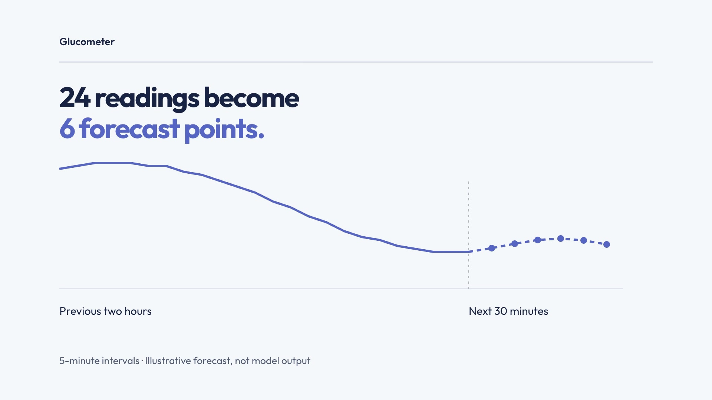

# Glucometer

**Predicting the next 30 minutes of glucose readings from the previous two hours.**

[](https://github.com/user-attachments/assets/d0d70548-f459-4dec-bc95-7179d46e0ad9)

*22-second walkthrough. The video uses an illustrative forecast, not recorded model output.*

## About the project

Glucometer is a machine-learning project with a Flask web interface. It uses recorded glucose, carbohydrate and insulin data to estimate how glucose readings might change over the next 30 minutes. It works with uploaded files, not a live sensor or physical glucose meter.

The project has two parts: a notebook that trains and compares **Transformer and LSTM models**, and a web app that uses the saved **Transformer model** to display forecasts. The notebook explores the modelling; the app makes the prediction flow accessible through a browser.

## How it works

1. **Upload XML** containing glucose history and any meal or insulin events.
2. **Prepare the data** into five-minute intervals, using the latest 24 readings as input.
3. **Predict six readings** covering the next 30 minutes.
4. **View the result** on a history-and-forecast chart, or download it as a PNG.

For example, with a last reading at **10:00**, the forecast covers **10:05 through 10:30**.

## Features

- XML upload with drag-and-drop support.
- Interactive glucose history and forecast chart.
- Latest reading, final predicted value and change summary.
- PNG chart download.
- Synthetic example file for trying the upload flow without patient data.

**Stack:** Python · Flask · TensorFlow/Keras · pandas · scikit-learn · Chart.js

## Run locally

Use **Python 3.11**. From a terminal on macOS or Linux:

```bash
git clone https://github.com/Atishmondi/Glucometer-flask-app.git
cd Glucometer-flask-app

python3.11 -m venv .venv
source .venv/bin/activate

python -m pip install -r requirements.txt
python run.py
```

On Windows, use `py -3.11 -m venv .venv` to create the environment and `.venv\Scripts\Activate.ps1` to activate it in PowerShell. The install and run commands are the same.

Open **http://127.0.0.1:5000**. Select [`examples/synthetic_patient.xml`](examples/synthetic_patient.xml), then click **Get Prediction**.

The sample contains made-up readings, not patient data. The trained model is included, so retraining is not required. Internet access is needed for installation and the chart's CDN assets.

## Repository guide

| Path | Purpose |
| --- | --- |
| `run.py` | Starts the local app. |
| `glucometer_app/ml_utils.py` | Prepares data, loads the model and runs predictions. |
| `glucometer_app/main/routes.py` | Handles uploads and results. |
| `glucometer_app/templates/` | Upload and result pages. |
| `glucometer_app/model/` | Saved Transformer model. |
| `notebooks/Glucometer_project.ipynb` | Transformer and LSTM training experiments. |
| `examples/synthetic_patient.xml` | Synthetic demo input. |

## Status and limitations

This is a research prototype. A full app/model-loading test was not completed during packaging, and no verified accuracy claim is made.

- The app fits a new scaler per upload instead of reusing the training scaler.
- The notebook's preprocessing and overlapping data windows need review for evaluation leakage.
- Invalid uploads and model-loading errors need better handling.
- Debug mode and the placeholder secret key make the current configuration unsuitable for public hosting.
- The green chart line at 100 mg/dL is a fixed reference, not a personalized target.

**Not clinically validated. Do not use predictions for treatment or insulin-dosing decisions.**

<details>
<summary><strong>Training notebook and input details</strong></summary>

Install the notebook dependencies and open Jupyter:

```bash
python -m pip install -r requirements-notebook.txt
jupyter lab notebooks/Glucometer_project.ipynb
```

The notebook expects `archive.zip` containing `559-ws-training.xml` from the Ohio dataset in its working directory. The original dataset is not included; obtain it under its applicable access and usage terms. The synthetic example is only for the app demo.

The experiments use 24 input intervals and six output intervals, with a chronological 70/15/15 train/validation/test split. The Transformer uses four encoder blocks; the comparison LSTM uses two 64-unit layers. Saved notebook outputs have been removed. A complete export procedure reproducing the bundled model is not yet included.

Input XML uses `glucose_level`, `meal` and `bolus` event groups, with `ts` and `value` attributes. Timestamps follow `DD-MM-YYYY HH:MM:SS`. See the complete synthetic example for the format. The app interpolates glucose gaps and fills missing meal and bolus values with zero.

</details>

## Author

[Atish Mondi](https://www.linkedin.com/in/atishmondi)

## License

No license file is currently included. Source and model licensing remain to be confirmed.
